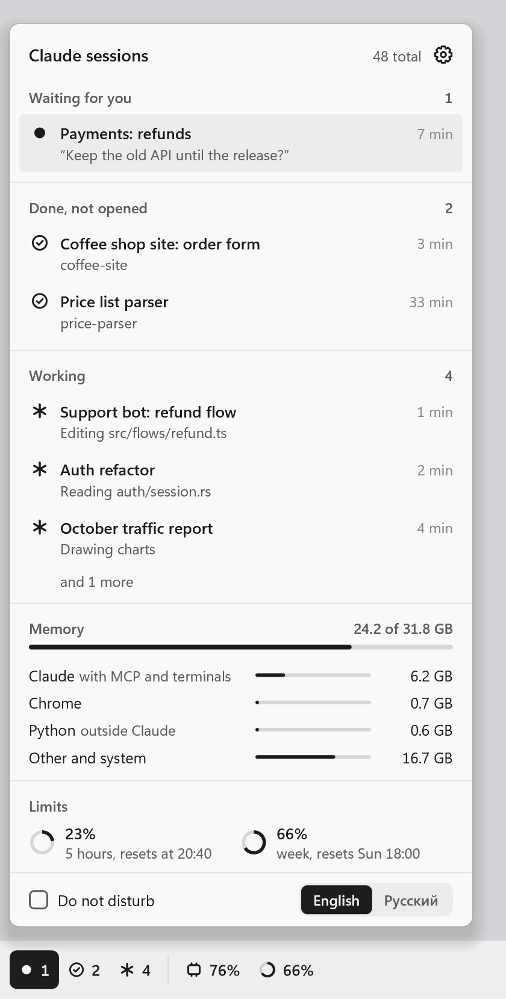
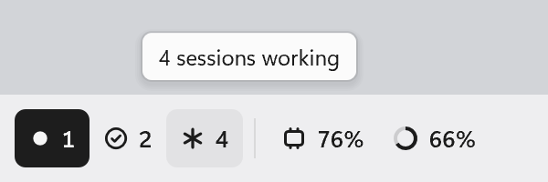
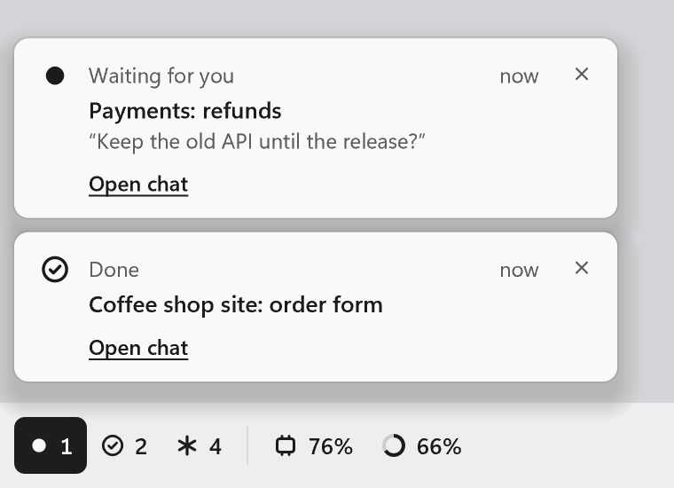
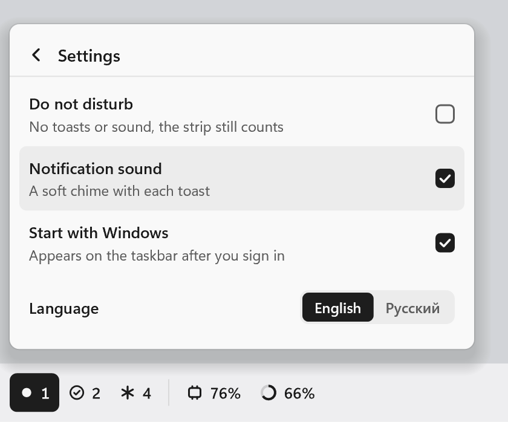
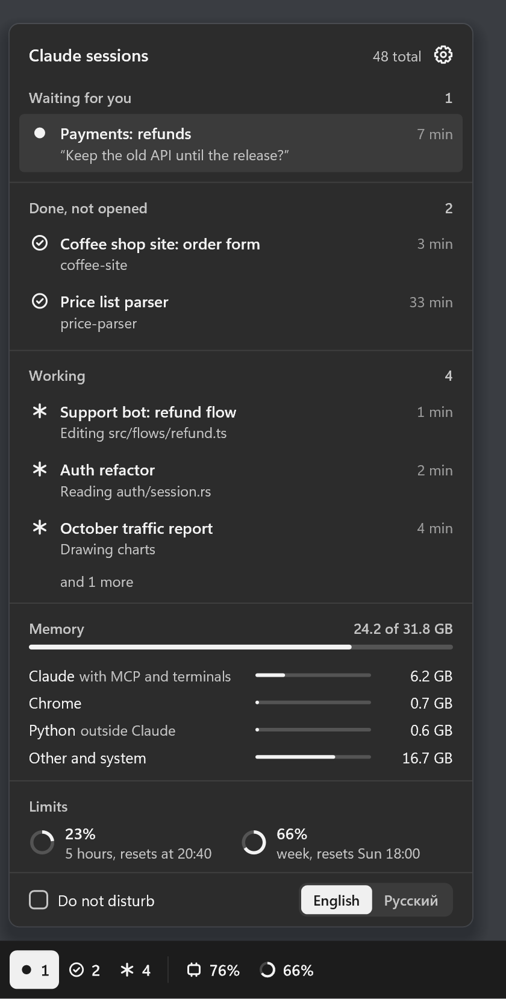
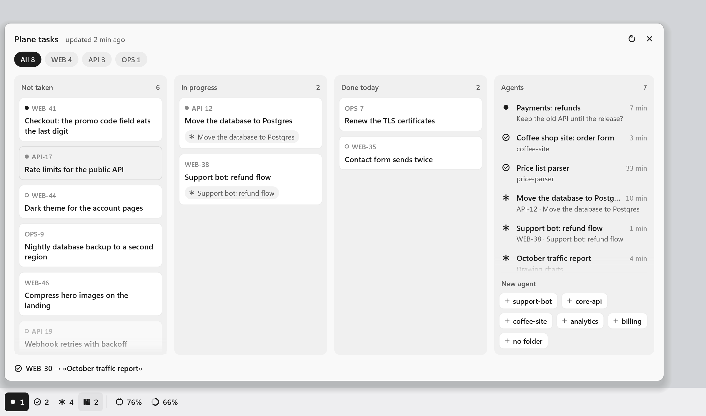
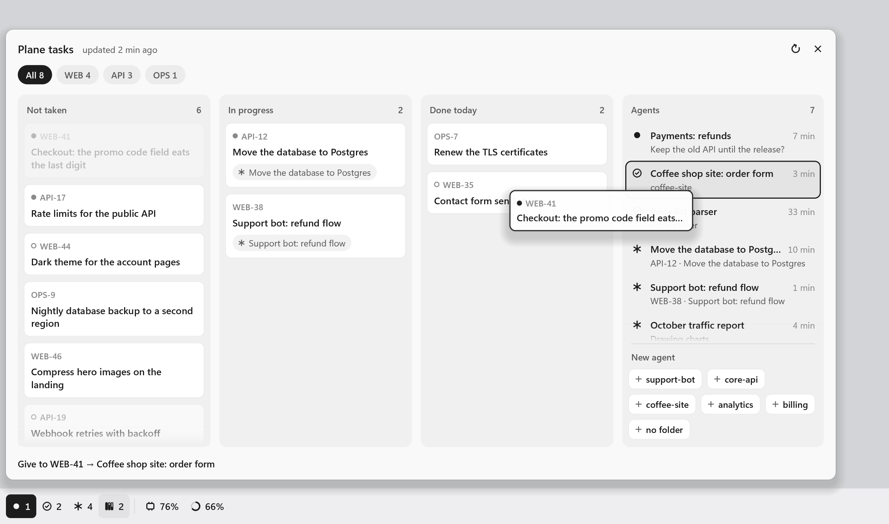

<p align="center"><b>English</b> · <a href="README.ru.md">Русский</a></p>

<div align="center">


# claudibeat

**Your Claude Desktop sessions, counted in the left corner of the Windows 11 taskbar.**

[](#requirements)
[](#build)
[](LICENSE)
[](#footprint)
[](#footprint)
[](#privacy)

</div>

<p align="center"></p>

When you run eight Claude sessions at once, the hard part isn't the work; it's noticing which one stopped to ask you something twenty minutes ago. claudibeat sits where the taskbar is empty anyway and answers three questions without opening a window: who's waiting for me, who has finished, who's still working. Next to that it shows how much memory is in use and how much of your Claude plan limit is gone.

Subagents don't count. One chat tab is one session, however many helpers it spawned.

<p align="center"></p>

## What you get

**The strip.** A filled dot for sessions waiting on you, a check for finished ones you haven't opened, the Claude Code asterisk for sessions at work. When anyone is waiting, that counter turns into a black pill so you see it from across the room. Zeros fade to 42% instead of disappearing, so the strip never jumps around. On the right: memory in use and a ring filled to the share of your plan limit already spent (the busier of the 5-hour and weekly windows).

**One click to the chat.** Click "waiting" or "done" when there's exactly one such session and the chat opens straight away; otherwise the sessions window opens. Hover anything for a plain-language tooltip.

<p align="center"></p>

**The sessions window.** Waiting sessions come first, longest wait on top, with the question they asked. Finished sessions show their project, working ones show what they're doing right now ("Editing src/flows/refund.ts"). Each group shows three rows and folds the rest into "and N more"; the list scrolls on its own if it reaches the top of the screen while memory and limits stay put. Esc or a click anywhere else closes it. The double check next to the gear marks every waiting and finished session seen, so none hangs there as waiting for you.

**Memory that tells you who's eating it.** Claude is counted together with every process it started (MCP servers, terminals, dev servers), so "Claude: 6.2 GB" means what you think it means. Chrome and Python outside Claude get their own lines. The numbers are private working sets, the same figure Task Manager's "Memory" column shows; on the author's machine the Claude group came out at 6,221 MB against 6,188 MB from the performance counters.

**Toasts that know when to shut up.**

<p align="center"></p>

- A toast appears only when a session changes state while claudibeat is watching. Starting it with five sessions already waiting gives you zero toasts.
- At most three on screen, newest at the bottom. A "done" toast leaves after 8 seconds (the timer stops while your pointer is on it); a "waiting" one stays until you open or dismiss it.
- Several sessions finishing within 2 seconds become one toast, and one session can't toast more than once per 10 seconds.
- Full-screen games and presentations hold toasts back, silently.
- Clicking a toast opens the chat and marks it seen. The cross only dismisses it; the counter stays.
- Opening the chat in Claude itself counts too: claudibeat reads when you last focused each chat (Claude's own `lastFocusedAt`), and the chat you're looking at when it finishes doesn't toast at all.
- A short soft chime is synthesised in memory (about −18 dBFS), never the system "ding". You can turn it off.

**Quiet when you need it.** Tick **Do not disturb** at the bottom of the sessions window and no toasts or sounds arrive. The strip keeps counting, so nothing is lost, and switching it off doesn't replay what you missed.

**Quiet helper chats.** Chats that another chat started stay out of the counts, the list, the board, the toasts and the sound, and the mod takes the blue dot off them in Claude's sidebar. One exception: a helper waiting for your answer shows up and toasts, or it would hang there unseen. A helper you filed into a group or pinned counts as an ordinary chat. On by default; switch it off in the settings or the menu.

**Settings in the same window.** The gear next to the title turns the sessions window into its settings: do not disturb, the notification sound, quiet helper chats, starting with Windows, the language. The arrow, or Esc, takes you back to the list.

<p align="center"></p>

**Light or dark, like the taskbar.** claudibeat follows "Choose your default Windows mode" and switches the moment you do: white counters on a dark taskbar, dark cards above it.

<p align="center"></p>

**Plane task board.** When the status-band mod fetches Plane, the strip gains an in-progress counter that opens a board: Not taken, In progress, Done today, and the live Claude chats beside them. Drag a task: dropped on a chat it goes there as a message, and the agent takes it, does it and closes it in Plane with a comment; dropped on a folder under New agent it starts a new chat there; dropped on another column it changes state. A click opens the task in Plane. claudibeat still never touches the network: the mod talks to Plane, claudibeat leaves it requests in the status-band folder.

<p align="center"></p>

<p align="center"></p>

**English or Russian.** English is the default. Pick **Русский** at the bottom of the sessions window, in the settings or in the right-click menu; the choice is remembered.

## Install

Pick one; each ends with the strip in your taskbar.

```powershell
irm https://raw.githubusercontent.com/PixelShino/claudibeat/main/install.ps1 | iex
```

```powershell
winget install PixelShino.claudibeat
claudibeat --setup
```

```powershell
scoop bucket add claudibeat https://github.com/PixelShino/claudibeat
scoop install claudibeat
claudibeat --setup
```

`claudibeat --setup` puts the status-band mod (built into the exe) in `%USERPROFILE%\.claude\mods\status-band`, adds it to `CLAUDE_CODE_PLUGIN_DIRS` in Claude's `settings.json`, turns on starting with Windows and starts the strip. Then open a new Claude chat: chats opened earlier run without the mod. If you already keep your own copy of the mod there, setup leaves it alone.

## Requirements

> **Early release.** claudibeat has been used every day on one machine: the author's Windows 11 (build 26200), one monitor, Claude Desktop as its MSIX package. Other Windows 11 builds, a Claude Desktop installed another way, several monitors or a different taskbar layout haven't been tried yet. If something looks wrong, [open an issue](https://github.com/PixelShino/claudibeat/issues) with `%USERPROFILE%\.claude\claudibeat\claudibeat.log` attached; that's how it gets tested on more machines.

- Windows 11 (tested on build 26200). The taskbar trick relies on Windows 11's layered child windows.
- [Claude Desktop](https://claude.ai/download) with the **status-band** mod ([mod/status-band](mod/status-band); `claudibeat --setup` installs it), which writes session state to `%USERPROFILE%\.claude\status-band\`. claudibeat only reads that folder; see [How it works](#how-it-works) for the exact files.

## Build

```powershell
rustup toolchain install stable-x86_64-pc-windows-gnu   # what the author builds with
cargo +stable-x86_64-pc-windows-gnu build --release
.\target\release\claudibeat.exe
```

The GNU toolchain needs no Visual Studio; the MSVC toolchain should work too but isn't tested yet. There's no runtime: one 1.1 MiB executable, the mod included. A second copy refuses to start.

## Use

- **Left click** a counter: open the one chat, or the sessions window.
- **Right click** the strip: Mark all as seen, Do not disturb, Notification sound, Quiet helper chats, Start with Windows (off by default), Language, Quit.
- **The gear** in the sessions window opens the same settings without the menu.
- Settings live in `%APPDATA%\claudibeat\settings.json`. Start with Windows is a Task Scheduler task named `claudibeat` that runs at your sign-in, on your desktop and without elevation. Not the `Run` key: on one Windows 11 machine Explorer silently skipped claudibeat there at every sign-in. Builds that used the `Run` key move the setting over by themselves.
- Started plainly, claudibeat is a guard: the strip runs as its child and comes back 2 s after a crash (at most 5 times in 10 minutes). Panics and every exit, with its reason, go to `%USERPROFILE%\.claude\claudibeat\claudibeat.log` (not AppData: a Claude chat sees its own package copy of AppData). Started from a Claude chat (Claude Desktop is an MSIX package, and what its chats start dies with it), claudibeat hands over to its sign-in task and leaves.
- `claudibeat.exe --quit` closes a running copy the way its Quit item does and waits for it to exit. Use it before replacing the executable rather than killing the process: after a forced kill, Explorer has refused the new strip for several minutes. `taskkill` without `/F` works the same way.
- `claudibeat.exe --render <dir> [--lang en|ru] [--theme light|dark]` draws every surface to PNG with invented demo sessions (that's where the pictures above come from). `claudibeat.exe --dump <file>` writes today's counts, memory and limits as JSON, handy for checking the numbers without any window.

## How it works

The strip is a layered child window of `Shell_TrayWnd`, painted with Direct2D into a premultiplied bitmap and handed over with `UpdateLayeredWindow`, so the taskbar's Mica shows through and text keeps grayscale antialiasing instead of ClearType fringes. Explorer destroys its children when it restarts; a hidden top-level window hears the `TaskbarCreated` broadcast and puts the strip back in under a second (0.97 s measured).

Session data comes from the status-band folder, contract version 1:

| File | Written by | What claudibeat does with it |
|---|---|---|
| `index.json` | status-band | list of Desktop sessions with their links |
| `sessions/<key>.json` | status-band | state, question, current activity |
| `account.json` | status-band | plan limit windows and reset times |
| `acks/<key>.json` | both | writes `{"v":1,"ackAt":…,"by":"claudibeat"}` when you open a chat here, so the mod's own strip stops nagging too |
| `board.json`, `assignments.json` | status-band | the Plane board and which chat holds which task |
| `requests/<id>.json` | claudibeat | a request: give a task to a chat, start a new chat, change state, refresh; claudibeat deletes it once answered |
| `replies/<id>.json`, `claims/<id>.json` | status-band | the answer, and which session runs it; claudibeat clears them after 3 minutes |
| `tray.json` | claudibeat | `{"v":1,"at":…,"quietHelpers":true}` every 10 s; while it's fresh, the mod stays quiet and one event makes one sound; `quietHelpers` asks the mod to clear the blue dot on helper chats |

A folder watcher reacts within about 150 ms; a 2-second re-read covers anything it misses. Session merging is a line-by-line port of the mod's `mergeRows`, and the two agree on the live folder (1 / 2 / 3 / 48 on the day it was checked).

## Footprint

Measured on the author's machine (16 logical CPUs, 32 GB RAM) over three minutes with six or seven sessions working, which keeps the status-band folder changing every few seconds. Only files whose size or time moved are read again, so a refresh over 77 sessions takes about 2 ms:

| | |
|---|---|
| Executable | 1,098 KiB with the mod inside (`lto`, `strip`, `panic = "abort"`) |
| Memory, private working set | 9.6 MB |
| CPU | 0.07% of the machine on average (1.1% of one core) |
| Back after an Explorer restart | 0.97 s |

## Privacy

claudibeat makes no network calls at all. It doesn't read `~/.claude/.credentials.json` or any token; plan usage comes from the file the mod already wrote. Inside the status-band folder it writes only `acks/` and `tray.json`.

## FAQ

**Does it work with Claude Code in a terminal?** It counts whatever status-band reports. Terminal sessions without a `claude://` link show up in the counts, but clicking them does nothing, and their rows don't pretend to be clickable.

**Why not the Windows notification center?** Those toasts land in the bottom-right corner and pile up in the Action Center. These sit next to the counter they belong to and vanish once they're handled. To avoid getting both, switch Claude Desktop's own banners off in Settings → Claude Code → Notifications.

**Multiple monitors?** The strip lives on the primary taskbar only.

## Authors

- Dmitry Goldobin ([@PixelShino](https://github.com/PixelShino)): idea, product decisions, design review on the live taskbar
- Claude (Anthropic): code, tests and the documents in `docs/`

## Acknowledgements

The trick that makes a layered window live inside the Windows 11 taskbar comes from [CodeZeno/Claude-Code-Usage-Monitor](https://github.com/CodeZeno/Claude-Code-Usage-Monitor) (MIT). See [NOTICE](NOTICE).

claudibeat isn't affiliated with or endorsed by Anthropic. Claude is a trademark of Anthropic, PBC.

## License

[MIT](LICENSE)
