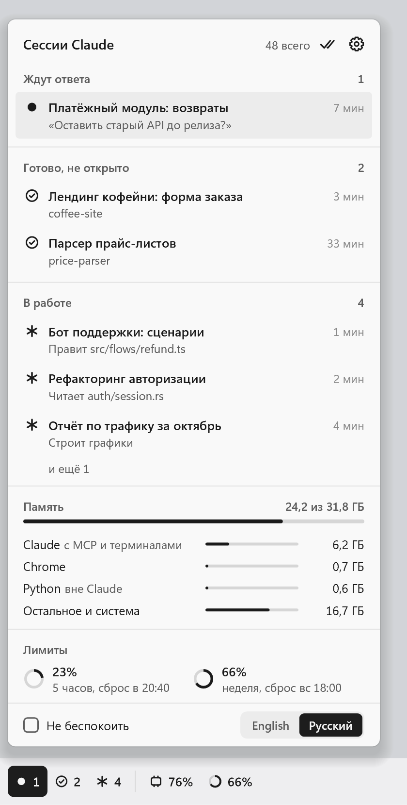
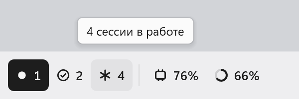
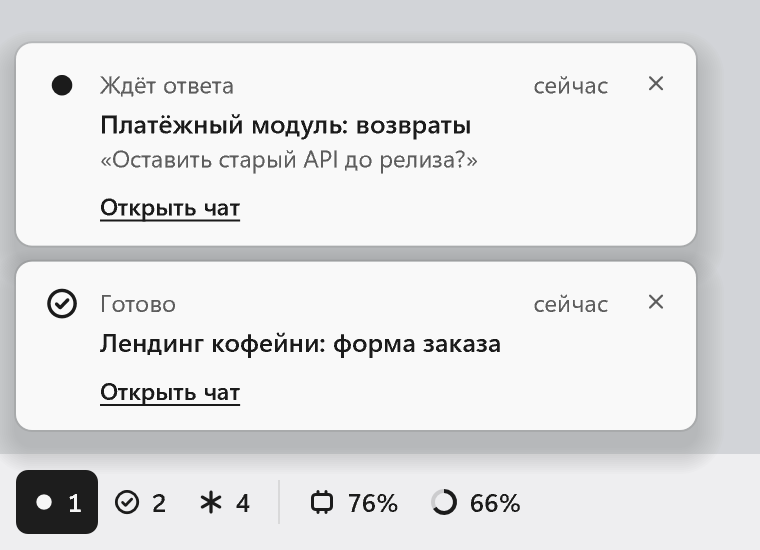
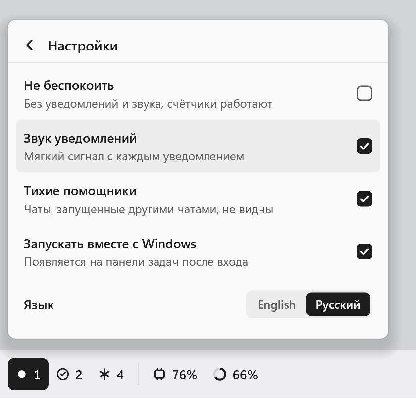
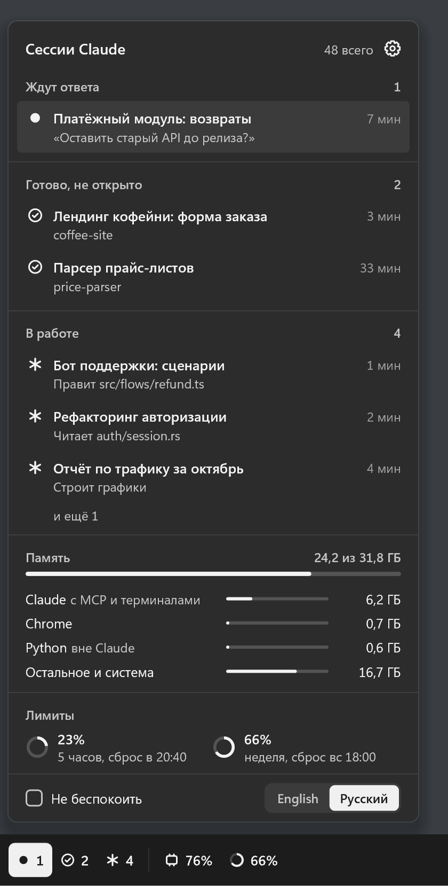
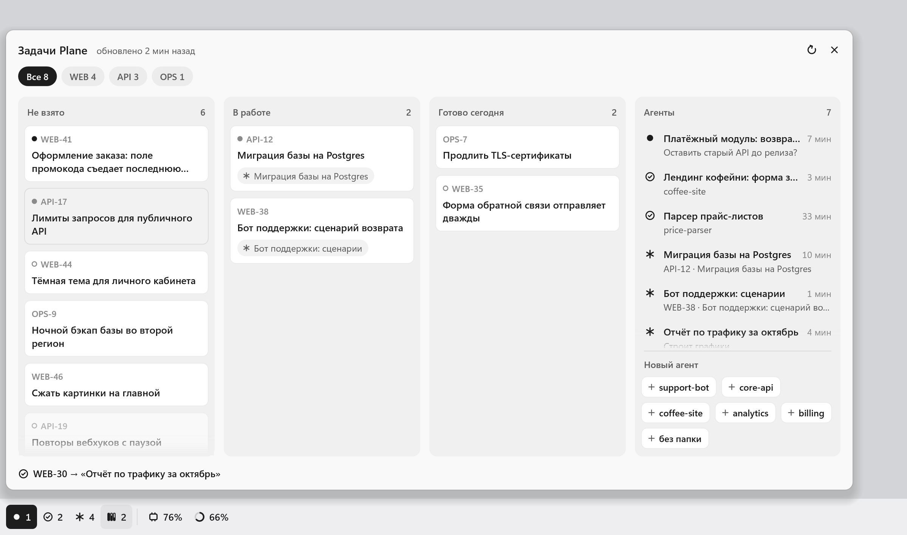
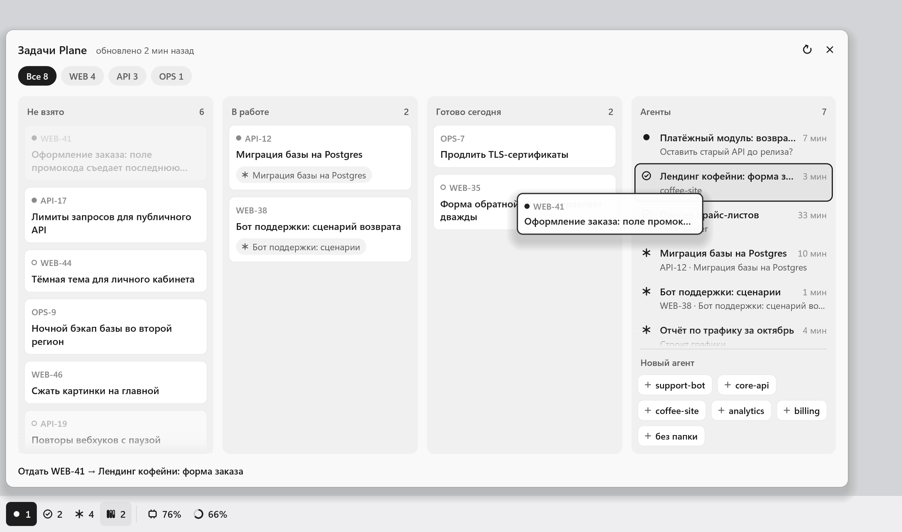

<p align="center"><a href="README.md">English</a> · <b>Русский</b></p>

<div align="center">


# claudibeat

**Сессии Claude Desktop на счету в левом углу панели задач Windows 11.**

[](#требования)
[](#сборка)
[](LICENSE)
[](#сколько-весит)
[](#сколько-весит)
[](#приватность)

</div>

Когда параллельно идут восемь сессий Claude, трудно не работать, а заметить, какая из них двадцать минут назад остановилась и задала вопрос. claudibeat занимает пустое место в левом углу панели задач и без единого окна отвечает на три вопроса: кто ждёт меня, кто закончил, кто ещё работает. Рядом видно, сколько занято памяти и какая часть лимита подписки уже израсходована.

Субагенты не считаются. Одна вкладка чата считается одной сессией, сколько бы помощников она ни запустила.

<p align="center"></p>

## Что умеет

**Полоса.** Закрашенная точка считает сессии, которые ждут вашего ответа; галочка считает закончившие, которые вы ещё не открыли; звёздочка, как у Claude Code, считает работающие. Если кто-то ждёт, счётчик становится чёрной плашкой, её видно издалека. Нули бледнеют до 42 %, но не исчезают, поэтому полоса не прыгает. Справа занятая память и кольцо, заполненное на израсходованную часть лимита (из окон на 5 часов и на неделю берётся более заполненное).

**Один клик до чата.** Если в «ждёт» или «готово» ровно одна сессия, клик сразу открывает её чат, иначе открывается окно сессий. При наведении на любой элемент появляется подсказка обычными словами.

<p align="center"></p>

**Окно сессий.** Сверху ждущие, дольше всех ждущие первыми, с текстом их вопроса. У готовых видно проект, у работающих видно, что они делают прямо сейчас («Правит src/flows/refund.ts»). В группе видно три строки, остальные сворачиваются в «и ещё N». Если окно упирается в верх экрана, прокручивается только список, а память и лимиты остаются на месте. Закрывается по Esc или клику мимо.

**Память с ответом, кто её съел.** Claude считается вместе со всеми процессами, которые он запустил (MCP-серверы, терминалы, dev-серверы), поэтому «Claude: 6,2 ГБ» означает ровно то, что кажется. Chrome и Python вне Claude показаны отдельными строками. Считается частный рабочий набор, как в столбце «Память» диспетчера задач; на машине автора группа Claude дала 6 221 МБ против 6 188 МБ по счётчикам производительности.

**Уведомления, которые знают меру.**

<p align="center"></p>

- Уведомление появляется только тогда, когда сессия меняет состояние на глазах у программы. Если при запуске уже ждут пять сессий, уведомлений не будет ни одного.
- На экране не больше трёх, новое снизу. «Готово» исчезает через 8 секунд (пока на нём курсор, таймер стоит), «Ждёт ответа» висит, пока его не откроют или не закроют.
- Несколько сессий, закончивших в пределах 2 секунд, дают одно уведомление, а одна сессия не уведомляет чаще раза в 10 секунд.
- В полноэкранной игре или презентации уведомления ждут, без звука.
- Клик по уведомлению открывает чат и отмечает его просмотренным. Крестик только закрывает уведомление, счётчик остаётся.
- Короткий мягкий звук собирается прямо в программе (около −18 dBFS), системный «динь» не используется. Звук можно выключить.

**Тишина, когда она нужна.** Поставьте галочку **Не беспокоить** внизу окна сессий, и уведомления со звуком приходить перестанут. Полоса продолжает считать, так что ничего не теряется, а после выключения пропущенное заново не всплывает.

**Тихие помощники.** Чаты, которые запустил другой чат, не попадают в счётчики, список, доску, уведомления и звук, а мод снимает с них синюю точку в боковой панели Claude. Исключение одно: помощник, который ждёт вашего ответа, виден и уведомляет, иначе он завис бы незаметно. Чат-помощник, которого вы положили в группу или закрепили, считается обычным. Включено по умолчанию, выключается в настройках или в меню.

**Всё просмотрено одной кнопкой.** Двойная галочка рядом с шестерёнкой отмечает все ждущие и готовые сессии просмотренными, и ни одна не висит как «ждёт вас».

**Настройки в том же окне.** Шестерёнка рядом с заголовком переключает окно сессий на настройки: «Не беспокоить», звук уведомлений, тихие помощники, запуск вместе с Windows и язык. Стрелка или Esc возвращают к списку.

<p align="center"></p>

**Светлая или тёмная, как панель задач.** claudibeat следует настройке «Режим Windows по умолчанию» и переключается сразу вместе с ней: на тёмной панели счётчики белые, окна над ней тёмные.

<p align="center"></p>

**Доска задач Plane.** Если мод status-band забирает задачи Plane, на полосе появляется счётчик «в работе», а по клику открывается доска: «Не взято», «В работе», «Готово сегодня» и справа живые чаты Claude. Задачу перетаскивают мышью. Брошенная на чат, она уходит туда сообщением, и агент берёт её в работу, делает и сам закрывает в Plane с комментарием. Брошенная на папку в «Новом агенте», она открывает новый чат в этой папке. Брошенная на другую колонку, она меняет статус. Клик по карточке открывает задачу в Plane. В сеть claudibeat по-прежнему не ходит: Plane опрашивает и двигает мод, а claudibeat оставляет ему заявки в папке status-band.

<p align="center"></p>

<p align="center"></p>

**Русский или английский.** По умолчанию интерфейс английский. **Русский** выбирается внизу окна сессий, в настройках или в меню по правому клику, выбор запоминается.

## Установка

Любой из способов; в конце полоса появляется в панели задач.

```powershell
irm https://raw.githubusercontent.com/PixelShino/claudibeat/main/install.ps1 | iex
```

```powershell
winget install PixelShino.claudibeat
claudibeat --setup
```

```powershell
scoop bucket add claudibeat https://github.com/PixelShino/claudibeat
scoop install claudibeat
claudibeat --setup
```

`claudibeat --setup` кладёт мод status-band (он встроен в exe) в `%USERPROFILE%\.claude\mods\status-band`, добавляет его в `CLAUDE_CODE_PLUGIN_DIRS` в `settings.json` Claude, включает запуск вместе с Windows и запускает полосу. После этого откройте новый чат в Claude: открытые раньше работают без мода. Если там уже лежит ваша собственная копия мода, установка её не трогает.

## Требования

- Windows 11 (проверено на сборке 26200). Встраивание в панель опирается на слоистые дочерние окна Windows 11.
- [Claude Desktop](https://claude.ai/download) с модом **status-band** ([mod/status-band](mod/status-band); его ставит `claudibeat --setup`), который пишет состояние сессий в `%USERPROFILE%\.claude\status-band\`. claudibeat только читает эту папку, точный список файлов в разделе [Как это работает](#как-это-работает).

## Сборка

```powershell
rustup toolchain install stable-x86_64-pc-windows-gnu   # так собирает автор
cargo +stable-x86_64-pc-windows-gnu build --release
.\target\release\claudibeat.exe
```

Набору GNU не нужна Visual Studio; MSVC тоже должен работать, но пока не проверялся. Рантайма нет: один исполняемый файл на 1,1 МиБ, мод уже внутри. Второй экземпляр не запускается.

## Как пользоваться

- **Левый клик** по счётчику открывает единственный чат или окно сессий.
- **Правый клик** по полосе: «Отметить всё просмотренным», «Не беспокоить», «Звук уведомлений», «Тихие помощники», «Запускать вместе с Windows» (по умолчанию выключено), «Язык», «Выход».
- **Шестерёнка** в окне сессий открывает те же настройки без меню.
- Настройки лежат в `%APPDATA%\claudibeat\settings.json`. Запуск вместе с Windows делает задание Планировщика `claudibeat`: оно срабатывает при вашем входе, на вашем рабочем столе и без повышения прав. Не ключ `Run`: на одной машине с Windows 11 Explorer молча пропускал там claudibeat при каждом входе. Сборки, которые писали в `Run`, переносят настройку сами.
- Запущенный обычным способом claudibeat — это сторож: полосу он ведёт дочерним процессом и, если тот упал, поднимает его через 2 с (не больше 5 раз за 10 минут). Паники и все выходы с причиной пишутся в `%USERPROFILE%\.claude\claudibeat\claudibeat.log` (не в AppData: чат Claude видит вместо неё копию своего пакета). Если claudibeat запустить из чата Claude (Claude Desktop — пакет MSIX, и всё, что запускают его чаты, умирает вместе с ним), он сам передаёт запуск задаче Планировщика и выходит.
- `claudibeat.exe --quit` закрывает запущенную копию так же, как пункт «Выход», и ждёт, пока она завершится. Запускайте его перед заменой exe вместо того, чтобы убивать процесс: после принудительного завершения Explorer по нескольку минут не принимал новую полосу. `taskkill` без `/F` закрывает так же мягко.
- `claudibeat.exe --render <папка> [--lang en|ru] [--theme light|dark]` рисует все окна в PNG на выдуманных демо-сессиях (картинки выше сделаны так). `claudibeat.exe --dump <файл>` пишет в JSON текущие счётчики, память и лимиты, чтобы сверить числа без окон.

## Как это работает

Полоса сделана слоистым дочерним окном `Shell_TrayWnd`. Direct2D рисует её в битмап с предумноженной альфой, а `UpdateLayeredWindow` выводит его на экран, поэтому сквозь полосу видна Mica панели, а текст сглажен в оттенках серого, без цветной каймы ClearType. При перезапуске Explorer уничтожает дочерние окна панели; невидимое окно верхнего уровня ловит сообщение `TaskbarCreated` и возвращает полосу меньше чем за секунду (замер: 0,97 с).

Данные о сессиях берутся из папки status-band, контракт версии 1:

| Файл | Кто пишет | Что с ним делает claudibeat |
|---|---|---|
| `index.json` | status-band | список сессий Desktop со ссылками |
| `sessions/<key>.json` | status-band | состояние, вопрос, текущее действие |
| `account.json` | status-band | окна лимитов подписки и время сброса |
| `acks/<key>.json` | оба | пишет `{"v":1,"ackAt":…,"by":"claudibeat"}`, когда вы открываете чат отсюда, и полоса самого мода тоже перестаёт напоминать |
| `board.json`, `assignments.json` | status-band | доска Plane и кто какую задачу держит |
| `requests/<id>.json` | claudibeat | заявка: отдать задачу чату, открыть новый чат, сменить статус, обновить доску; claudibeat удаляет её, получив ответ |
| `replies/<id>.json`, `claims/<id>.json` | status-band | ответ на заявку и отметка, какая сессия её выполняет; claudibeat убирает их через 3 минуты |
| `tray.json` | claudibeat | `{"v":1,"at":…,"quietHelpers":true}` раз в 10 с; пока файл свежий, мод молчит, и одно событие звучит один раз; `quietHelpers` просит мод снимать синюю точку с чатов-помощников |

Слежение за папкой срабатывает примерно за 150 мс, а перечитывание раз в 2 секунды подхватывает всё, что слежение пропустило. Сведение сессий перенесено построчно из функции мода `mergeRows`, и на живой папке их подсчёты совпали (1 / 2 / 3 / 48 в день проверки).

## Сколько весит

Замер на машине автора (16 логических процессоров, 32 ГБ памяти), три минуты, в работе шесть-семь сессий, поэтому папка status-band меняется каждые несколько секунд. Заново читаются только файлы, у которых изменились размер или время, и обновление по 77 сессиям занимает около 2 мс:

| | |
|---|---|
| Исполняемый файл | 1098 КиБ вместе с модом (`lto`, `strip`, `panic = "abort"`) |
| Память, частный рабочий набор | 9,6 МБ |
| Процессор | в среднем 0,07 % всей машины (1,1 % одного ядра) |
| Возврат после перезапуска Explorer | 0,97 с |

## Приватность

claudibeat не ходит в сеть совсем. Он не читает `~/.claude/.credentials.json` и токены; данные о лимитах берутся из файла, который уже записал мод. В папке status-band программа пишет только `acks/`, `requests/` и `tray.json`.

## Вопросы

**Работает ли с Claude Code в терминале?** Считается всё, что сообщает status-band. Терминальные сессии без ссылки `claude://` попадают в счётчики, но клик по ним ничего не делает, и их строки не притворяются кликабельными.

**Почему не центр уведомлений Windows?** Его уведомления появляются в правом нижнем углу и копятся в центре уведомлений. Эти стоят рядом со своим счётчиком и исчезают, как только с ними разобрались. Чтобы не получать оба вида, выключите баннеры самого Claude Desktop в Settings → Claude Code → Notifications.

**Несколько мониторов?** Полоса живёт только на панели основного монитора.

## Авторы

- Дмитрий Голдобин ([@PixelShino](https://github.com/PixelShino)): идея, продуктовые решения, приёмка дизайна на живой панели
- Claude (Anthropic): код, тесты и документы в `docs/`

## Благодарности

Приём, которым слоистое окно встраивается в панель задач Windows 11, взят у [CodeZeno/Claude-Code-Usage-Monitor](https://github.com/CodeZeno/Claude-Code-Usage-Monitor) (MIT). Подробности в [NOTICE](NOTICE).

claudibeat не связан с Anthropic и не одобрен ею. Claude является товарным знаком Anthropic, PBC.

## Лицензия

[MIT](LICENSE)
